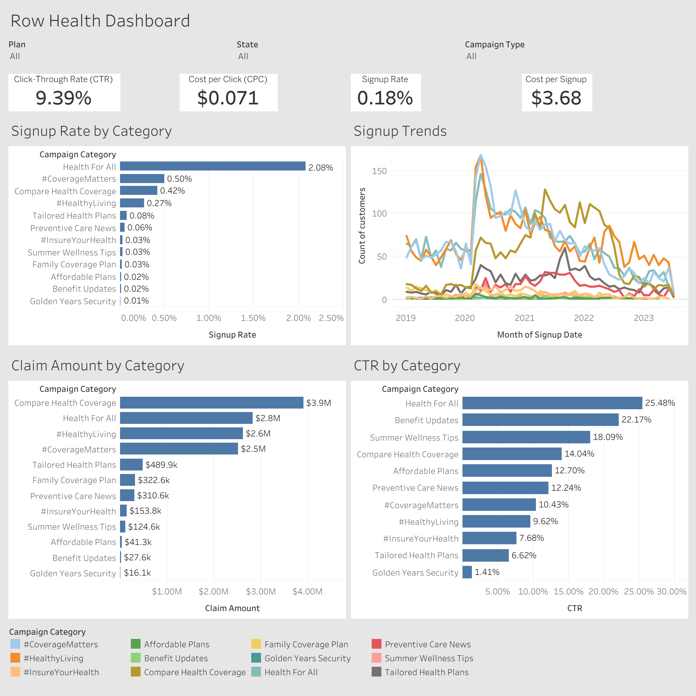

# Row Health - Marketing Campaign Dashboard

Interactive Tableau dashboard analyzing marketing campaign performance, customer signups, and insurance claims for a sample healthcare insurance company.

[View the interactive Tableau dashboard](https://public.tableau.com/app/profile/matt.hitch/viz/RowHealth-MarketingCampaignDashboard/RowHealthDashboard)

## Business Problem & Context

Row Health is a U.S.-based health insurance company offering four insurance plans: Bronze, Silver, Gold, and Platinum.

The company wanted greater visibility into its marketing campaigns, customer acquisition, and subsequent insurance claims. This project brings those metrics together in an interactive Tableau dashboard to support campaign performance monitoring and exploration.

## Dashboard

The dashboard includes four headline metrics:

- **Click-Through Rate (CTR):** Percentage of campaign impressions resulting in clicks.
- **Cost per Click (CPC):** Marketing spend divided by clicks.
- **Signup Rate:** Customer signups divided by campaign impressions.
- **Cost per Signup:** Marketing spend divided by customer signups.

Supporting visualizations compare signup rates, click-through rates, and claim amounts across campaign categories, alongside customer signup trends over time.

Interactive filters allow users to explore campaign types, insurance plans, and states.

## Data & Technical Process

The dashboard was built in Tableau using three related Excel tables:

- **Campaigns:** Marketing categories, types, impressions, clicks, and costs.
- **Customers:** Customer signups, insurance plans, and geographic information.
- **Claims:** Insurance claims and associated amounts.

The process included establishing table relationships, creating calculated fields for marketing and acquisition metrics, developing visualizations, and configuring interactive dashboard filters.

Plan and State filters apply to signup trends and claim amounts. Campaign-wide performance metrics remain unfiltered by these dimensions because corresponding plan- and state-level marketing spend and impression data are unavailable.

The completed dashboard is published on Tableau Public.